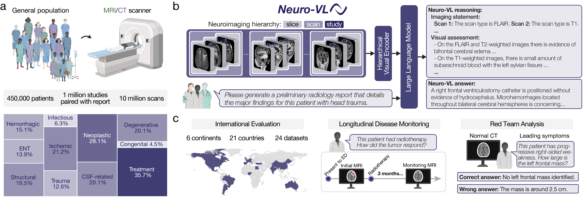

<h1 align="center">Neuro-VL</h1>

<p align="center">
  <strong>A vision-language model for clinical interpretation of 3D neuroimaging.</strong><br>
  <i>University of Michigan</i>
</p>

<p align="center">
  <a href="https://huggingface.co/mlinslab/neuro-vl-8b-thinking">Model weights</a> ·
  <a href="https://neurovl.mlins.org/">Online demo</a> ·
  <a href="#getting-started">Getting started</a> ·
  <a href="#evaluation">Evaluation</a> ·
  <a href="#training">Training</a> ·
  <a href="https://github.com/MLNeurosurg/neurobench">NeuroBench</a>
</p>

<p align="center">
  <a href="https://huggingface.co/mlinslab/neuro-vl-8b-thinking"></a>
  <a href="https://huggingface.co/datasets/mlinslab/neurobench"></a>
</p>

## 🧠 Overview

**Neuro-VL** is a vision-language model for neuroradiology. It processes full imaging **studies** comprising one or more **3D scans** to answer questions and generate radiology reports. It also supports longitudinal inputs containing multiple studies.

This repository provides the model implementation and code for inference and training. This model was released alongside **NeuroBench** ([GitHub](https://github.com/MLNeurosurg/neurobench), [Hugging Face](https://huggingface.co/datasets/mlinslab/neurobench)), an open-source evaluation benchmark for clinical neuroimaging interpretation.



## 📢 Updates

- **(2026-11)** Initial launch of Neuro-VL, including the [online demo](https://neurovl.mlins.org/), [model weights](https://huggingface.co/mlinslab/neuro-vl-8b-thinking), [evaluation dataset (NeuroBench)](https://huggingface.co/datasets/mlinslab/neurobench), and this official implementation.

<a id="getting-started"></a>

## 🚀 Getting started

### 1. Install

Clone the repository and create the Conda environment:

```bash
git clone https://github.com/MLNeurosurg/neuro-vl.git
cd neuro-vl
conda env create -f ./environment.yaml
conda activate neuro_vl
```

### 2. Download weights

Download the [Neuro-VL model weights](https://huggingface.co/mlinslab/neuro-vl-8b-thinking) from Hugging Face:

```python
from huggingface_hub import snapshot_download

model_dir = snapshot_download(
    repo_id="mlinslab/neuro-vl-8b-thinking",
    local_dir="/path/to/neuro-vl-8b-thinking",
    token=True
)

print(f"Checkpoint folder: {model_dir}")
```

### 3. Run a demo

Run a local example with the downloaded weights:

```bash
python demo.py --model /path/to/neuro-vl-8b-thinking/ --input CQ500CT107 --user_prompt "What do you see?"
```

The `--input` argument selects the example study. `CQ500CT107`, `ReMIND-071/study_1`, and `ReMIND-071/study_2` are single-study examples. `ReMIND-071` is a longitudinal example containing multiple studies taken at different timepoints.

Use `--provide_scan_type` to provide the scan type explicitly for each input scan. Otherwise, the model predicts the scan type from the image features.

<a id="evaluation"></a>

## 📊 Evaluation

Download the preprocessed scans from the [NeuroBench dataset](https://huggingface.co/datasets/mlinslab/neurobench) in the tensor format expected by Neuro-VL:

```python
from pathlib import Path
from huggingface_hub import snapshot_download

snapshot_download(
    repo_id="mlinslab/neurobench",
    repo_type="dataset",
    allow_patterns="data/tensor/**",
    local_dir="./neurobench_data",
)

root = Path("./neurobench_data/data/tensor/rsna")
for batch in root.glob("batch_[0-4]"):
    for patient in batch.iterdir():
        patient.rename(root / patient.name)
    batch.rmdir()
```

Download the corresponding question CSVs from [NeuroBench](https://huggingface.co/datasets/mlinslab/neurobench). Configure the model, scan, CSV, and output paths in the [inference scripts](src/neuro_vl_test/scripts/), then run them to generate responses for each question.

To score the generated responses, follow the preparation and evaluation instructions in the [NeuroBench repository](https://github.com/MLNeurosurg/neurobench). Use the generated CSV with `--candidate_answer "neuro-vl answer" "Neuro-VL"` to select the model response column.

<a id="training"></a>

## 🛠️ Training

Pretrain the visual encoder using [HLIP](https://github.com/zch0414/hlip), or download the [pretrained visual encoder](https://huggingface.co/zch0414/clip-vit_large-slice_scan_study-dualdinotxt1568) from Hugging Face. Run the commands below from `src/neuro_vl_sft/`, replacing the placeholder paths with your data and checkpoint locations.

### Stage 1

```bash
export WANDB_PROJECT=neuro-vl

accelerate launch --config_file ./fsdp_config.yaml main.py \
--stage stage-one \
--train_data /path/to/mri/='"/path/to/hlip/mri/train.txt"' /path/to/ct/='"/path/to/hlip/ct/train.txt"' \
--valid_data /path/to/mri/='"/path/to/hlip/mri/valid.txt"' /path/to/ct/='"/path/to/hlip/ct/valid.txt"' \
--max_num_scans 8 \
--visual_resolution 8 7 7 \
--context_length 4096 \
--visual_encoder_name vit_large_slice_scan_study_dualdinotxt1568 \
--visual_encoder_path /path/to/hlip.pt \
--language_model_name_or_path /path/to/Qwen3-8B \
--system_message "You are Qwen, created by Alibaba Cloud. You are a helpful assistant." \
--output_dir /path/to/neuro_vl/ \
--freeze_visual_encoder \
--freeze_language_model \
--gradient_checkpointing \
--num_train_epochs 1 \
--per_device_train_batch_size 8 \
--per_device_eval_batch_size 1 \
--dataloader_num_workers 16 \
--gradient_accumulation_steps 8 \
--learning_rate 1e-3 \
--lr_scheduler_type cosine \
--warmup_ratio 0.03 \
--weight_decay 0.0 \
--bf16 \
--tf32
```

### Stage 2

Use the connector checkpoint saved by Stage 1.

```bash
export WANDB_PROJECT=neuro-vl

accelerate launch --config_file ./fsdp_config.yaml main.py \
--stage stage-two \
--train_data /path/to/mri/='"/path/to/neuro_vl/mri/train.txt"' /path/to/ct/='"/path/to/neuro_vl/ct/train.txt"' \
--valid_data /path/to/mri/='"/path/to/neuro_vl/mri/valid.txt"' /path/to/ct/='"/path/to/neuro_vl/ct/valid.txt"' \
--max_num_scans 8 \
--visual_resolution 8 7 7 \
--context_length 5632 \
--visual_encoder_name vit_large_slice_scan_study_dualdinotxt1568 \
--visual_encoder_path /path/to/hlip.pt \
--connector_path /path/to/neuro_vl/run_stage_one/connector_checkpoint.pt \
--language_model_name_or_path /path/to/Qwen3-8B \
--use_confession_statement \
--enable_thinking \
--system_message "You are Neuro-VL, created by MLiNS @ University of Michigan. You are a helpful assistant." \
--output_dir /path/to/neuro_vl/ \
--gradient_checkpointing \
--num_train_epochs 1 \
--per_device_train_batch_size 4 \
--per_device_eval_batch_size 1 \
--dataloader_num_workers 16 \
--gradient_accumulation_steps 8 \
--learning_rate 2e-5 \
--visual_encoder_learning_rate 2e-6 \
--lr_scheduler_type cosine \
--warmup_ratio 0.03 \
--weight_decay 0.0 \
--bf16 \
--tf32
```

### Stage 3

Use the visual encoder, connector, and language model checkpoints saved by Stage 2.

```bash
export WANDB_PROJECT=neuro-vl

accelerate launch --config_file ./fsdp_config.yaml main.py \
--stage stage-three \
--train_data /path/to/mri/='"/path/to/neuro_vl/mri/train_longitudinal.csv"' /path/to/ct/='"/path/to/neuro_vl/ct/train_longitudinal.csv"' \
--valid_data /path/to/mri/='"/path/to/neuro_vl/mri/valid_longitudinal.csv"' /path/to/ct/='"/path/to/neuro_vl/ct/valid_longitudinal.csv"' \
--max_num_scans 16 \
--visual_resolution 8 7 7 \
--encode_studies_independently \
--context_length 8192 \
--visual_encoder_name vit_large_slice_scan_study_dualdinotxt1568 \
--visual_encoder_path /path/to/neuro_vl/run_stage_two/vit_large_slice_scan_study_dualdinotxt1568.pt \
--connector_path /path/to/neuro_vl/run_stage_two/connector_checkpoint.pt \
--language_model_name_or_path /path/to/neuro_vl/run_stage_two/Qwen3-8B \
--enable_thinking \
--system_message "You are Neuro-VL, created by MLiNS @ University of Michigan. You are a helpful assistant." \
--output_dir /path/to/neuro_vl/ \
--gradient_checkpointing \
--num_train_epochs 1 \
--per_device_train_batch_size 2 \
--per_device_eval_batch_size 1 \
--dataloader_num_workers 16 \
--gradient_accumulation_steps 16 \
--learning_rate 1e-5 \
--visual_encoder_learning_rate 2e-6 \
--lr_scheduler_type cosine \
--warmup_ratio 0.03 \
--weight_decay 0.0 \
--bf16 \
--tf32
```

## 🤝 Support

For questions, bug reports, or feedback, please [open an issue](https://github.com/MLNeurosurg/neuro-vl/issues).

## 📖 Citation

Neuro-VL was released alongside [NeuroBench](https://github.com/MLNeurosurg/neurobench). The Neuro-VL/NeuroBench manuscript and citation are coming soon.

For the related language-image pretraining work, please cite:

```bib
@article{zhao2026towards,
  title={Towards Scalable Language-Image Pre-training for 3D Medical Imaging},
  author={Chenhui Zhao and Yiwei Lyu and Asadur Zaman Chowdury and Edward S Harake and Akhil Kondepudi and Akshay T Rao and Xinhai Hou and Honglak Lee and Todd C Hollon},
  journal={Transactions on Machine Learning Research},
  issn={2835-8856},
  year={2026},
  url={https://openreview.net/forum?id=WxHf4EcBWA}
}
```
